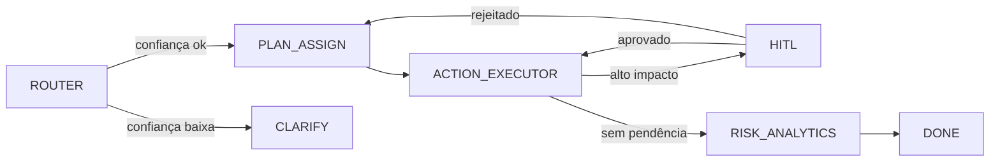

# Agent-OS

Agente de IA de **gerenciamento de projetos sobre o Jira**: faz triagem e roteamento de demandas, decompõe
ideias em Epics, Stories e Sub-tasks, executa as ações no Jira, avalia riscos e **pausa para aprovação humana**
(HITL) antes de qualquer ação de alto impacto.

Este repositório é um **MVP funcional**: roda de ponta a ponta com um Jira simulado (sem credenciais) e traz um
cliente REST do Jira Cloud como ponto de partida para uso real.

## Como funciona



| Nó | Função | Arquivo |
| --- | --- | --- |
| `ROUTER` | Classifica intenção e domínio; abaixo de 0.85 de confiança, pergunta em vez de agir | `nodes/router.py` |
| `PLAN_ASSIGN` | Cria o plano Epic > Stories > Sub-tasks, extrai data e entregáveis, delega a humanos ou agentes | `nodes/plan_assign.py` |
| `ACTION_EXECUTOR` | Executa CRUD no Jira de forma idempotente; ações de alto impacto ficam pendentes | `nodes/action_executor.py` |
| `HITL` | Pausa o fluxo e só retoma com decisão humana; pendências expiradas geram lembrete, nunca aprovação | `nodes/hitl.py` |
| `RISK_ANALYTICS` | Previsão de data, gargalos de WIP e nível de risco | `nodes/risk_analytics.py` |

O estado compartilhado (State Schema) está em `src/agent_os/state.py`; a política de aprovação, em `policy.py`;
o system prompt do agente, em `prompts.py`.

### Ações que exigem aprovação humana

Iniciar/fechar Sprint, definir data comprometida, criar regra de Automation, reatribuir issues de humanos,
cancelar trabalho com progresso, mover issues entre projetos e edições em lote acima de 10 issues.
**Excluir issues é proibido**, em qualquer caso.

## Instalação (VS Code)

Requer Python 3.10 ou superior.

```bash
git clone <URL-do-seu-repositorio> agent-os
cd agent-os
python -m venv .venv
# Windows:  .venv\Scripts\activate      |  macOS/Linux:  source .venv/bin/activate
pip install -e ".[dev]"
```

No VS Code: abra a pasta, escolha o interpretador `.venv` (Ctrl+Shift+P > *Python: Select Interpreter*) e instale
as extensões recomendadas. A pasta `.vscode` já traz configurações de teste e de depuração (F5).

## Uso

```bash
agent-os demo --approve-all                # três pedidos de exemplo
agent-os run "Precisamos lançar o novo plano Pro em 30 de novembro, com landing page, e-mail de lançamento e suporte treinado."
agent-os run "..." --domain engineering    # força o domínio
agent-os run "..." --show-state            # imprime o State Schema final (JSON)
```

### Motor LangGraph (opcional)

Os nós são funções puras `(estado, contexto) -> estado`, então rodam em dois motores: o nativo (`graph.py`,
sem dependências extras) e o LangGraph (`langgraph_graph.py`, mesmo comportamento, validado por testes).

```bash
pip install -e ".[langgraph]"
agent-os run "..." --engine langgraph
```

Em um terminal interativo, o HITL pergunta `Aprovar esta ação? [s/N]`. Sem terminal, use `--approve-all` ou
`--reject-all`. Também funciona como biblioteca:

```python
from agent_os import AgentGraph, AgentState, build_context, render_response

graph = AgentGraph(build_context())
state = graph.run(AgentState.new("Lançar o plano Pro em 30 de novembro, com landing page e e-mail"))
if state.status.value == "awaiting_approval":
    state = graph.resume(state, {"commit-date": True}, by="gerente")
print(render_response(state))
```

### Testes

```bash
pytest -q
ruff check src tests
```

## Usando o Jira real

1. Copie `.env.example` para `.env` e preencha `JIRA_BASE_URL`, `JIRA_EMAIL`, `JIRA_API_TOKEN` e `JIRA_PROJECT_KEY`
   ([como criar um token de API](https://id.atlassian.com/manage-profile/security/api-tokens)).
2. Rode com `--real-jira` (ou `AGENT_OS_USE_MOCK=false`).

Limitações do cliente REST (`tools/rest_jira.py`), que **não foi validado contra uma instância real**:
revise tipos de issue e campos obrigatórios do seu projeto; Sprints e regras de Automation ainda não são
implementados (a ação falha e vira item de risco); o responsável sugerido vai na descrição, pois a atribuição
real exige o `accountId` do usuário.

## Limitações do MVP

- Roteamento por palavras-chave (opcionalmente LLM, com `pip install -e ".[llm]"` e `AGENT_OS_USE_LLM_ROUTER=true`);
  abaixo do limiar, o agente pergunta.
- Previsão de data = pontos estimados / velocidade semanal (`Settings.velocity_points_per_week`): heurística, calibre com o histórico do time.
- O quadro do modo simulado usa **dados fictícios** (por isso o gargalo em "Code Review" aparece na demo).
- Intenções `refine_backlog` e `review` ainda não implementadas; GitHub, Figma e Slack ainda não integrados.

## Roadmap

- [x] Motor LangGraph opcional (`--engine langgraph`), com os mesmos nós do motor nativo
- [ ] Checkpointer persistente do LangGraph (estado e fila de aprovações sobrevivem a reinícios)
- [ ] Integrações de leitura: GitHub (PRs/commits), Figma, Slack (notificações e aprovações)
- [ ] Refinamento de Backlog e planejamento de Sprint com estimativa por histórico
- [ ] Persistência do estado e fila de aprovações
- [ ] Métricas: cycle time, acurácia de roteamento, previsibilidade

## Publicando no GitHub

```bash
git init
git add .
git commit -m "feat: MVP do Agent-OS"
git branch -M main
git remote add origin https://github.com/<seu-usuario>/agent-os.git
git push -u origin main
```

Antes de publicar, confirme que o `.env` não está versionado (`git status` não deve listá-lo).

## Licença

MIT
